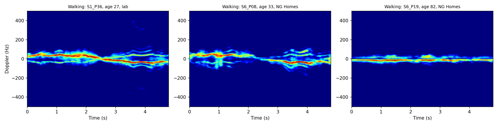
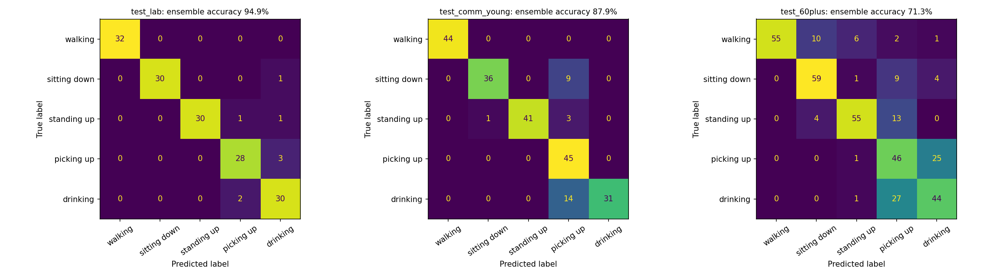
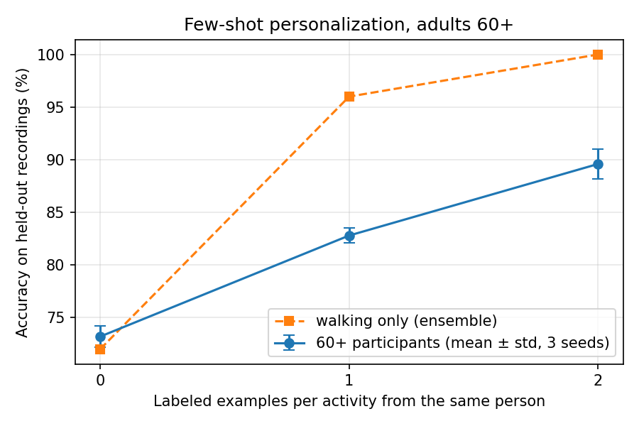

# Radar Activity Recognition Across Age Groups: Domain Shift and Few-Shot Personalization

**A radar activity-recognition model trained on young adults loses a quarter of its accuracy on older adults in real community settings, and misreads their walking, the key frailty signal. A personal baseline (per-person normalization) corrects the environment but not age-related movement changes. Two labeled examples per activity from each person raise accuracy for adults aged 60+ from 73% to 90%, and walking recognition from 72% to 100%.**

## Motivation

Unobtrusive sensors such as radar are promising for monitoring frailty and fall risk at home: they need no wearable, and they don't capture identifiable images. But activity-recognition models are typically developed with young volunteers in laboratories, while the people who would benefit most are older adults in their own homes.

This study asks:
1. How much does a radar activity-recognition model degrade when moving from young adults in a lab to older adults in community settings?
2. How much of that degradation comes from the **new environment**, and how much from **age-related changes in movement**?
3. Can a **personal baseline** or a **few labeled examples per person** close the gap?

## Data

[Radar signatures of human activities](https://doi.org/10.5525/gla.researchdata.848) (Fioranelli et al., University of Glasgow, 2019; CC BY 4.0): 1,754 recordings from a 5.8 GHz FMCW radar (400 MHz bandwidth, 1 ms chirps, 128 samples per chirp). Participants performed walking, sitting down, standing up, picking up an object, and drinking (2–3 repetitions each), plus simulated falls in the lab only. Recordings come from a university lab (ages 21–44), a housing association (NG Homes, ages 24–88), and an Age UK centre (ages 25–98). Two duplicated files were excluded, leaving 1,752.

Falls were excluded from the cross-age experiments, because almost none were recorded outside the lab.

## Signal processing

Each recording is converted into a micro-Doppler spectrogram, which shows the velocities of different body parts over time:

1. **Range FFT** (Hann window) within each chirp, giving the reflection strength at each distance.
2. **Clutter removal:** 4th-order Butterworth high-pass filter across chirps, applied forwards and backwards (zero-phase) to remove static reflections without a start-up artifact.
3. **Adaptive range window:** ±10 range bins around the bin with the most motion energy. Participants stood at different distances in different rooms (centre bins 37–61, median 51), so a fixed range band would miss them in many recordings.
4. **STFT** across chirps (0.2 s Hann window, 95% overlap, 256 frequency bins, ±500 Hz), summed over the range window, in absolute dB.
5. The **4.8-second window with the most motion** is kept and downsampled to 128 Doppler bins × 240 time frames.

Absolute signal levels are preserved, so that normalization strategies can be compared fairly.

*Walking at ages 27 (lab), 33 (housing association) and 82 (housing association). The older participant's signature is much narrower, consistent with slower walking and less limb swing.*

## Experimental design

Splits are made **by participant**, so all recordings of a person are in the same split.

| Split | Participants | Recordings | Mean age | Role |
|---|---|---|---|---|
| Train | 46 (lab) | 679 | 27.3 | Training |
| Validation | 9 (lab) | 130 | 29.4 | Model selection |
| Test: lab | 11 (lab) | 158 | 26.2 | In-domain test |
| Test: community <60 | 15 | 224 | 43.4 | Effect of a new location |
| Test: community 60+ | 25 | 363 | 74.2 | Effect of a new location *and* older age |

Comparing the two community groups separates the effect of location from the effect of age.

**Model:** ResNet-18 pre-trained on ImageNet, adapted to 1-channel input, with dropout 0.2. AdamW (lr 5e-4, weight decay 0.05), cosine schedule, 30 epochs, batch size 32, mixed precision. Augmentation: random time shifts (±0.6 s) and Doppler flips (mirroring "toward" and "away from" the radar). The best epoch is chosen on lab validation data only. Each configuration is trained with 3 seeds (~25 s per run on a Colab T4).

**Normalization strategies:**
- **Global:** one mean and standard deviation from all training data.
- **Per-recording:** each spectrogram is standardized by its own statistics.
- **Per-person:** each participant's spectrograms are standardized by statistics from all of that person's recordings. This needs no labels, so a deployed system could learn it from unlabeled data collected in the home.

## Results

### 1. Domain shift and normalization

Test accuracy (%), mean ± std over 3 seeds:

| Normalization | Lab | Community <60 | Community 60+ |
|---|---|---|---|
| Global | 93.7 ± 1.3 | 78.3 ± 2.5 | 67.3 ± 2.5 |
| Per-recording | 92.2 ± 2.2 | 80.2 ± 6.8 | 67.0 ± 2.0 |
| **Per-person** | **93.9 ± 1.0** | **86.9 ± 1.4** | **70.0 ± 1.5** |

- **Both shifts are substantial.** A new location costs ~15 points; a new location plus older age costs ~26 points.
- **Per-person normalization removes more than half of the location gap** (78.3% → 86.9%), with low variance across seeds.
- **It barely affects the age gap.** A ~17-point gap remains between community participants under 60 and those 60+. Normalization rescales signals but cannot change the *shape* of movement, and older adults move differently.
- **Per-recording normalization is unstable** (72–84% across seeds on the under-60 group): scaling each recording separately discards information that is consistent within a person.

### 2. Error analysis and uncertainty

Ensemble of the three per-person models (averaged probabilities):

| | Lab | Community <60 | Community 60+ |
|---|---|---|---|
| Ensemble accuracy | 94.9% | 87.9% | 71.3% |
| Walking accuracy | 100% | 100% | **74.3%** |
| Mean entropy, correct predictions | 0.11 | 0.20 | 0.35 |
| Mean entropy, wrong predictions | 0.69 | 0.65 | 0.68 |
| Accuracy on the 80% most confident | 99.2% | 95.5% | **76.9%** |

- **Older adults' walking is misread** as sitting down or standing up (16 of 74 walks). Walking is perfectly recognized in both younger groups. Since gait is among the most important frailty indicators, this is the most consequential failure.
- **Picking up and drinking are confused in both directions** for older adults: both are slow, small upper-body movements.
- **Uncertainty is informative but not sufficient.** Wrong predictions have much higher entropy in every group, and deferring the 20% least confident cases lifts the younger groups to 95–99%. For older adults it only reaches 76.9%, because many age-related errors are made *confidently*.

### 3. Few-shot personalization

For each of the 25 participants aged 60+, one recording per activity was held out. The model was fine-tuned on k = 1 or 2 labeled recordings per activity from the same person (5 or 10 recordings; 30 steps, lr 1e-4, batch-normalization statistics frozen). All conditions are evaluated on the same 122 held-out recordings.

| Labeled examples per activity | 0 | 1 | 2 |
|---|---|---|---|
| Accuracy (mean ± std, 3 seeds) | 73.2 ± 1.0 | 82.8 ± 0.7 | **89.6 ± 1.4** |
| Ensemble accuracy | 77.0 | 88.5 | **92.6** |
| Walking (ensemble) | 72.0 | 96.0 | **100.0** |

- **Two labeled examples per activity raise accuracy for older adults from 73% to 90%**, roughly the level of younger community participants with per-person normalization.
- **Walking recovers fastest:** a single labeled walk per person lifts it from 72% to 96%.
- Picking up remains the hardest activity. Per-activity results rest on ~24 test recordings each (one recording ≈ 4 points), so small differences between activities are not meaningful.

## Conclusions

1. Models trained on young adults in a lab do not transfer reliably to older adults in community settings.
2. A personal baseline, learned from unlabeled data, corrects most of the environment-related shift but not age-related changes in movement.
3. Many errors on older adults are confident, so uncertainty-based flagging alone cannot catch them.
4. A handful of labeled examples per person closes most of the remaining gap, especially for walking.

For frailty monitoring, this suggests modeling activity *relative to each person's own baseline*, rather than relying on a population model trained on young volunteers.

## Limitations

- **Same session:** labeled examples and test recordings were made on the same day and in the same room. Real deployment spans weeks to months, during which behavior changes. In frailty monitoring that change is the signal, so personalization must adapt to the person without absorbing the decline it should detect.
- **No group-level control:** the experiment does not test whether examples from *other* older adults would help as much as a person's own examples.
- **Scripted activities:** short, separately performed activities, not continuous daily life.
- **Moderate sample size:** 25 participants aged 60+, and ~24 test recordings per activity in the personalization experiment.
- **Falls** could not be evaluated across age groups.
- **Interference:** constant narrow-band interference lines are visible in some spectrograms and were not removed.

## Future work

- Longitudinal personalization: continual adaptation that tracks a person's baseline while detecting gradual change.
- Group-level vs. individual adaptation, and unsupervised adaptation using unlabeled home data.
- Detecting gradual deviations from a personal baseline as digital biomarkers of frailty, e.g., declining walking speed, which appears directly in the Doppler spread.
- Fusion of radar with thermal sensing, and evaluation on continuous, real-world recordings.

## Repository contents

- The Colab notebook, with all steps in order and explanations.
- `results/`: figures and CSV files for all experiments (`results.csv`, `error_uncertainty_analysis.csv`, `fewshot_personalization.csv`).

`results/spectrogram_examples.png` comes from an early version of the pipeline with a fixed range band, before the adaptive range window was introduced; `results/fall_diagnostics.png` shows the range-time analysis that motivated the fix.

## Reproducing

Open the notebook in Google Colab with a T4 GPU runtime, mount Google Drive, and run all cells in order. The dataset (2 GB) is downloaded once to Drive; spectrograms are computed once (~12 minutes) and cached. Training results are saved after every run, so the notebook resumes after a disconnection. All randomness is seeded.

## Acknowledgement

Dataset: F. Fioranelli, S. A. Shah, H. Li, A. Shrestha, S. Yang, J. Le Kernec, *Radar signatures of human activities*, University of Glasgow, 2019, doi:10.5525/gla.researchdata.848 (CC BY 4.0).

## Author

Mubashar Abbas, MS Data Science (NUST, 2026). Research interests: reliable and personalized machine learning for sensor data, domain shift, uncertainty-aware learning.
